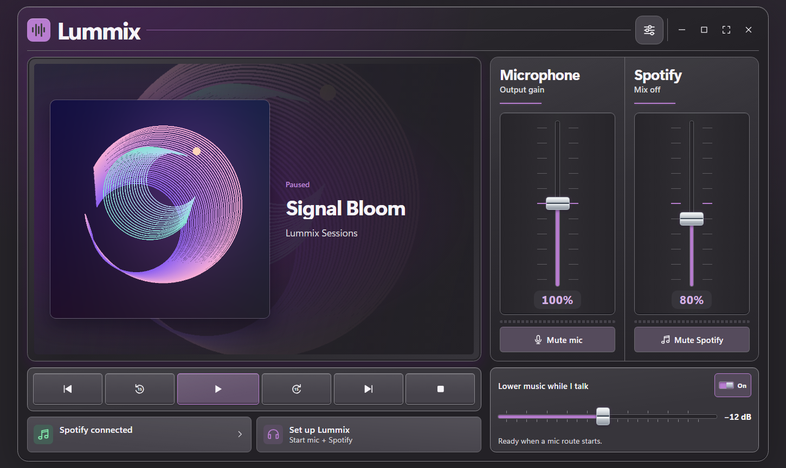
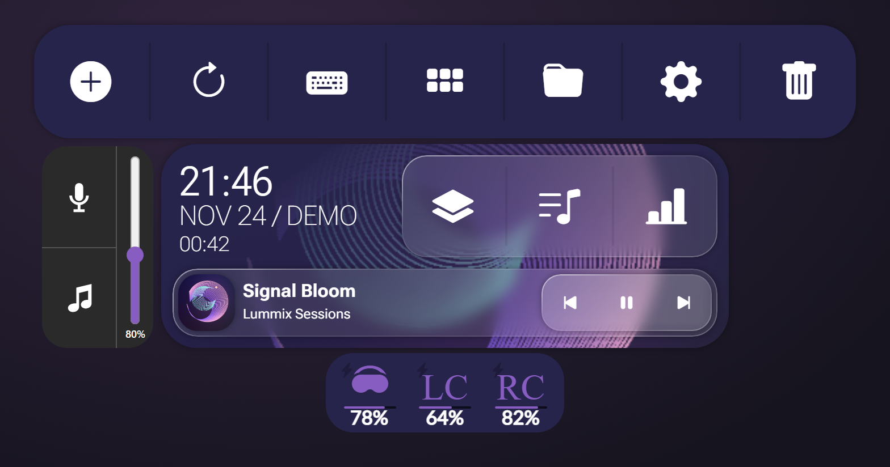

# Lummix

Lummix gives VRChat one microphone for your voice and music. It mixes your Windows microphone with your local Spotify player. Two faders set what reaches the game, and the music fades under your voice when you speak. Mixing runs on your PC without an AI service or a Lummix account.

| Desktop mixer | XSOverlay wrist preview |
| --- | --- |
| [](docs/mixer.png) | [](docs/xsoverlay-wrist.png) |

**[Download Lummix 1.0.5 for Windows x64](https://github.com/lumberjackfrog/Lummix/releases/download/v1.0.5/Lummix.Setup.exe)** · [Prerelease notes and SHA-256](https://github.com/lumberjackfrog/Lummix/releases/tag/v1.0.5)

## Start a mix

The Windows installer is unsigned. Windows may show a publisher warning, and a PC configured to require trusted publishers can block the install.

1. Open **Lummix Setup.exe**. It installs Lummix for your Windows account and opens the mixer. Double-click **Lummix** on your desktop to reopen it. You can also find it in Start. If you delete the shortcut, run Setup again to restore it.
2. Play a song in the Spotify desktop app and click **Set up Lummix**. Lummix finds your mic, reuses or installs VB-CABLE, and shows the recording device name. Approve the Windows driver prompt if it appears.
3. In **VRChat → Settings → Audio & Voice → Microphone**, choose **Lummix (VB-Audio Virtual Cable)**, or the exact name shown by setup. Speak and watch the input meter. VRChat remembers the selection separately for desktop and VR mode.

Next session, open Lummix and start the mix. **Stop mix** releases the microphone and music capture.

## At the controls

| Control | What it changes |
| --- | --- |
| Microphone and Spotify faders | Independent outgoing gains from 0–200%. The center is unity gain. Set your personal playback volume in Spotify. |
| Lower music while I talk | Starts at 12 dB of reduction. The music fades down over 350 ms, holds through short pauses, then returns over one second. |
| Settings → Audio | Choose Auto detect or a particular mic, and set slider movement to Smooth, 5, 10, or 20 percentage points. |
| Settings → Wrist & appearance | Follow album artwork or keep your own background. |
| Desktop window | Drag the Lummix header to move it. The top-right buttons minimize, maximize or restore, toggle fullscreen, and close. F11 toggles fullscreen and Escape leaves it. Close keeps the mixer in the system tray by default. Choose **Exit Lummix** from the tray to quit. |

**Using XSOverlay?** Open **Settings → XSOverlay → Install add-on** in Lummix. Restart XSOverlay, open the music note on your wrist, and use the mic, music mute, and music gain beside the clock. For compact wrist layouts, open **Lummix** from XSOverlay’s Apps menu. Keep Lummix running while using the controls. They adjust the same outgoing mix as the desktop.

After a Steam repair or update, Settings can check the installed files and reapply the add-on. You can remove it from the same screen. The desktop mixer also works without XSOverlay.

## If you hear yourself

Open **Windows Sound → Recording → Lummix → Properties → Listen** and clear **Listen to this device**. That switch plays a copy of the outgoing mix in your headphones. Your headset or audio interface can also have its own mic monitoring control.

If the mixer reports that Spotify is already playing directly into the cable, open **Windows Settings → System → Sound → Volume mixer** and set **Spotify → Output device** to **Default**. If music is missing in the game, play a track locally, check the Spotify meter in Lummix, then check the microphone meter in VRChat.

## Compatibility

Use 64-bit Windows 11, or an x64 Windows build numbered 20348 or later, with Microsoft Edge WebView2. Install the Spotify desktop app from Spotify’s website or the Microsoft Store. Playback on a phone or another Spotify Connect device supplies no local audio to mix. The optional wrist view requires the user’s own XSOverlay installation. A first-time VB-CABLE install can require a Windows restart.

Lummix saves your Spotify locations, microphone choice, gains, ducking, window placement and appearance for your Windows account. A local recovery copy in `%LOCALAPPDATA%\Lummix\settings-backup.json` restores saved settings if an individual file goes missing or becomes invalid. After reinstalling Spotify, Lummix checks its current installation.

If Windows media controls stop responding, Lummix can still detect the desktop or Store player. When Spotify exposes its playback buttons, Lummix can use them for Play/Pause, Previous and Next. When Windows omits artwork, Lummix reads the album or track link from Spotify’s Now Playing bar and requests its cover from Spotify. The image stays in memory and is shared with the wrist preview. Seeking requires the Windows media session.

## Build and test

The browser interface lives in `studio/` and the audio, device discovery and desktop window live in `windows/`. The one-file installer is built from `setup/Lummix.nsi`. The Windows build instructions list the native toolchain and verified vendor downloads. [Windows build guide](windows/BUILD.md)

The UI smoke tests run without a microphone, Spotify account or headset.

```powershell
python -m pip install -r tests/ui/requirements.txt
python -m playwright install chromium
python -m unittest discover -s tests/ui -v
```

Audio libraries, vendor components and their distribution terms are documented in [Third-party notices](THIRD_PARTY.md).
