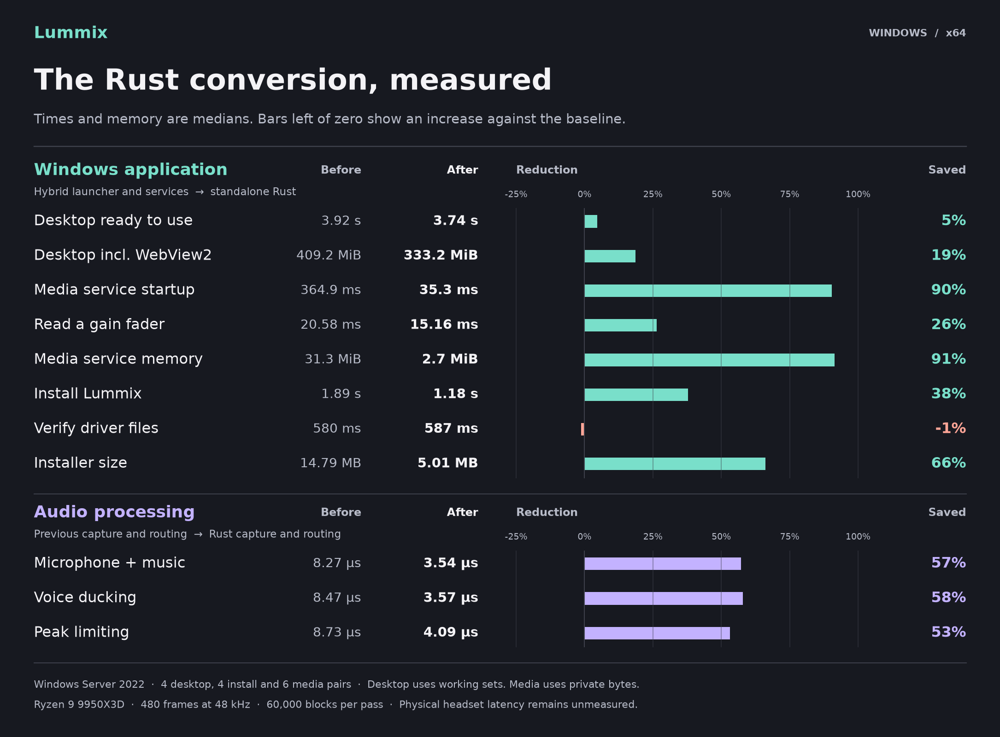

# Windows audio port

Lummix captures the selected microphone and the verified Spotify renderer, mixes them in Rust, and writes stereo audio to the selected VB-CABLE endpoint. The process-loopback worker, packet queue, speech detector, gain ramps, limiter and device callback run without a Python callback. The capture and render threads use a bounded queue. The capture worker checks the process creation time and discards its old queue when the selected renderer changes.

## Measurements

Measured on an AMD Ryzen 9 9950X3D running Windows x64. The baseline is commit `c8a5a2d`, which already used Rust for the inner sample mix. Both builds processed the same 48 kHz input. Each measurement covers delivering a process packet and running the complete device callback through the test driver. Each workload ran three times per build with 60,000 blocks per run. The table gives the median time per 480-frame block. [Audio samples](benchmarks/audio.json)

| Workload | Previous implementation | Rust capture and routing | Speedup |
| --- | ---: | ---: | ---: |
| Mic and music | 8.266 µs | 3.539 µs | 2.34× |
| Speech ducking | 8.470 µs | 3.574 µs | 2.37× |
| Peak limiting | 8.734 µs | 4.087 µs | 2.14× |

All 403,200 compared output samples matched exactly. The replay covers volume and mute changes, quiet input, split packets, overflow, discontinuities and limiting. Only the test DLL exposes packet injection.

On two dedicated Windows virtual endpoints, the new callback negotiated 240 frames and a reported output buffer of 27.04 ms. The previous callback used 480 frames and reported 32.04 ms. Both reported 22.04 ms at the input. The test observer includes the control pipe, Windows scheduling and its own capture buffer. Two alternating before/after experiments each measured 64 gain changes per build.

| Gain change at the output | Previous median | Rust median | Previous p90 | Rust p90 |
| --- | ---: | ---: | ---: | ---: |
| First device run | 65.1 ms | 66.7 ms | 80.2 ms | 74.9 ms |
| Repeat with Rust loading the driver | 77.8 ms | 66.4 ms | 83.5 ms | 84.3 ms |

All eight runs reported zero xruns. The two runs show a consistent reduction in processing time and configured output buffering. The direction of the change in observed control latency varies between runs.

The 5 ms request applies when both devices advertise low latency of at most 5 ms. Lummix retries the standard 10 ms request and then the high-latency settings if the device rejects the faster mode. Independent tone tests exercised both mutes, double gain and 12 dB of voice ducking at the Windows output. A physical headset and VRChat add their own audio buffers and network delay.

## Signal arrival at a Windows receiver

A second test changed the level of a generated tone in a real Windows renderer. It timed the change from the generator callback to its first confirmed appearance in the mixer's captured output. A second process-loopback tap watched the source. Both taps required two consecutive blocks at the new level and recorded the first block's time. This includes Windows buffering and observer scheduling.

Each row covers 64 level changes per build. A denotes the previous build and B the Rust port. Each letter starts a fresh route on the same dedicated virtual devices.

| Trial and order | Previous median | Rust median | Previous p90 | Rust p90 |
| --- | ---: | ---: | ---: | ---: |
| First, ABBA | 159.5 ms | 151.0 ms | 168.5 ms | 165.2 ms |
| First, BAAB | 148.0 ms | 153.5 ms | 167.9 ms | 163.5 ms |
| Repeat, ABBA | 165.6 ms | 171.5 ms | 174.6 ms | 174.4 ms |
| Repeat, BAAB | 167.5 ms | 136.6 ms | 177.2 ms | 174.0 ms |

All four comparisons completed with zero reported callback underruns or overruns. Median signal arrival varied enough between route starts that these results do not establish a consistent latency improvement at the receiver.

## Installer and migration

The standalone Windows build runs its launcher, setup, Spotify and local mixer services in Rust. Its installer contains 17,620 nonblank lines of first-party Rust out of 22,036 runtime lines (79.96%). The desktop and wrist use 4,378 lines of HTML, CSS and JavaScript, and Windows setup uses 38 lines of PowerShell. The installer contains zero Python source files, Python extension modules or Python interpreters. Python remains in the repository for building, testing and comparing against previous implementations. The counts exclude tests, tooling and third-party code. WebAssembly is counted once from the Rust that produced it. [Installer audit script](../scripts/count-native-source.py)

The shipped 1.0.8 installer was 42,824,066 bytes. The intermediate hybrid installer was 14,787,610 bytes with 61.65% Rust. The standalone candidate was 5,014,554 bytes. [Hybrid installer and upgrade checks](https://github.com/lumberjackfrog/Lummix/actions/runs/45869354743)

The same Windows Server 2022 x64 runner compared the hybrid installer with the exact standalone EXE supplied for testing. Each desktop launch used a fresh profile and waited until the real mixer displayed its controls. Four alternating pairs measured desktop startup and four measured per-user installation. Six pairs measured the media service. Each row gives the median across trials. [Windows samples](benchmarks/windows.json) · [Benchmark run](https://github.com/lumberjackfrog/Lummix/actions/runs/45882706350)

| Measurement | Hybrid | Standalone Rust |
| --- | ---: | ---: |
| Visible window | 2.45 s | 2.28 s |
| Mixer ready to use | 3.92 s | 3.74 s |
| Desktop working sets including WebView2 | 409.2 MiB | 333.2 MiB |
| Media service ready | 364.9 ms | 35.3 ms |
| Gain API response | 20.58 ms | 15.16 ms |
| Gain API p95 | 24.97 ms | 15.95 ms |
| Media service private memory | 31.34 MiB | 2.71 MiB |
| Per-user install | 1.89 s | 1.18 s |
| Driver file verification | 580 ms | 587 ms |

Desktop memory sums the Lummix and WebView2 working sets within each trial. Shared pages can appear in more than one process. The Lummix processes fell from 120.2 to 44.6 MiB. WebView2 used about 289 MiB in both builds. The separate media memory figure measures private bytes after the first Spotify status request.

Reading a gain fader measures one local API request. The Windows receiver tests above measure when audio actually arrives. The installation timing covers Lummix itself. Checking the bundled driver files took about 7 ms longer in this run. The separate installer qualification covered a 1.0.8 upgrade, fresh installs, repair and uninstall. [Installed application checks](https://github.com/lumberjackfrog/Lummix/actions/runs/45879692339)

## Reproduce

- Run the manual **Lummix checks** GitHub workflow to build both revisions, compare their samples and save timing JSON in the `audio-verification` artifact.
- Run `windows/tests/device_route.py` on Windows with the named, idle Steam virtual devices to check actual capture, routing and gain. The test checks the system defaults and active sessions before opening a stream.
- Run `windows/tests/route_latency.py --baseline <previous-checkout> --output latency.json` with the same Python test environment and built release DLLs to compare device timing. The baseline checkout must include its own built DSP.
- Run `windows/tests/signal_latency.py --baseline <previous-checkout> --order ABBA --output signal-abba.json` and repeat with `--order BAAB --output signal-baab.json` to time audio arriving at the receiver. Use the same dedicated Windows virtual devices, and run the two commands sequentially.
- Enable the hybrid comparison in the **Build and verify Windows installer** workflow to compare the two shipped payloads on one Windows runner. To benchmark an installer you already tested, supply its successful build run ID in the comparison input.
- With Matplotlib installed, run `python scripts/plot-native-benchmarks.py docs/benchmarks/windows.json docs/benchmarks/audio.json docs/rust-benchmarks.png` to redraw the chart from the Windows and audio results.
- Run `scripts/count-native-source.py --help` for an installer-backed language inventory. It checks the installer digest, inspects the MSI file table and compares its shipped interface files to the source commit.
